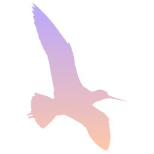

  

<h1 align="center">Godwit</h1>

  
  
  
  

  <b>One native app for all your chat networks.</b> 
  About 26 MiB idle with three networks signed in. Sign in to each once, and
  your friends, servers and calls sit side by side, so hopping between them
  takes a click instead of another app.

  <a href="#download"><b>Download</b></a>
  &nbsp;·&nbsp;
  <a href="#what-it-can-do"><b>What it can do</b></a>

> **godwit** */ˈɡɒdwɪt/*, noun. A long-billed wading bird. The bar-tailed
> godwit makes the longest nonstop migration of any bird: from Alaska to New
> Zealand and Australia, over 11,000 km of open ocean in about nine days,
> without landing to eat or rest. It travels in flocks.

> Early and in active development: test builds work day to day, with rough
> edges. Vibe coded with AI assistance. Use at own risk.

Godwit is heavily based on [Yapfast](https://github.com/yapfast/yapfast) for
its memory efficiency, and aims to keep up with that project.

> **Disclaimer.** Godwit is an independent, unofficial project. It is not
> affiliated with, endorsed by or sponsored by Stoat, Discord, Steam, Fluxer,
> Microsoft Teams, Slack, Google Chat, or any other network or company it
> connects to; their names belong to their owners and are used only to say
> what Godwit works with. Some networks' terms don't allow third-party
> clients, and using one may get an account limited or closed. **Use Godwit
> entirely at your own risk**: it comes with no warranty of any kind (see
> [LICENSE](LICENSE)).

## What it's for

One light native client for all your chat apps, instead of a browser tab or
a heavy app per network.

- **One place for everything:** every account's chats, servers, friends and
  calls, with one look and one set of shortcuts.
- **Easy to hop between:** a friend you know on several networks is one
  contact, with each network a tab away.
- **Efficient:** drawn natively, with a small memory footprint and nothing
  running while idle.
- **Plain about privacy:** each chat shows whether it's end-to-end encrypted.

## Download

**[Latest release](https://github.com/NetrunningChoom/Godwit/releases/latest)**:
one file per platform.

| Platform | Download | Then |
|---|---|---|
| Linux (x86-64) | `godwit-linux-x86_64` | make it executable (`chmod +x godwit-linux-x86_64`, or tick "Allow executing" in its file properties) and run it |
| Windows 10/11 (x86-64) | `godwit-windows-x86_64.exe` | run it (Windows may warn about an unknown publisher: "More info" → "Run anyway") |

On first start Godwit offers to **add itself to your apps**: it moves to your
user's apps folder and appears in the app menu (on Windows: the Start menu and
the desktop). No admin rights needed. Said "Not now"? Settings › About has the
same button, and the one to remove it again.

Godwit **updates itself**: now and then it looks for a newer release and asks
before installing it ("Update and restart"), checked against the project's
signing key. Set `GODWIT_NO_UPDATE=1` to turn that off. Each release lists
`SHA256SUMS`.

### Linux compatibility

- **x86-64** (64-bit Intel/AMD). No ARM builds yet.
- **glibc 2.35 or newer**: Ubuntu 22.04+, Debian 12+, Fedora 36+, Linux Mint 21+,
  Pop!_OS 22.04+, openSUSE Tumbleweed, Arch and others as recent. Not musl-based
  systems (Alpine).
- **Wayland or X11**, any desktop.
- **Sound**: PulseAudio or PipeWire.
- **Video players** (inline videos, embeds): WebKitGTK 4.1 (`libwebkit2gtk-4.1`),
  installed on most desktops; everything else works without it.
- **Sign-ins** are kept in your keyring (GNOME Keyring, KWallet or any Secret
  Service); without one, in owner-only files.

## What it can do

Rough and honest: the expandable [feature overview](#feature-overview) below
compares Godwit's client-side features with the official clients. Some features
are incomplete or still need live verification. Network protocols and
account/server policies can also limit what is available.

Not there yet: no ARM Linux builds; macOS untested; Android planned. And the
whole thing is early: expect rough edges everywhere, not just in the
work-in-progress networks.

<strong>Feature overview</strong> — what works and what’s still in progress

Compared with each network's official desktop or web client, based on the current
implementation, network notes and parity audits (November 2026). The lists aim to
cover the main user-visible workflows, including important features Godwit does not
yet offer; they are not a claim of endpoint-by-endpoint parity. “In progress” includes
incomplete features, known issues and items that have not been confirmed against a
live account. Features intentionally excluded by policy, such as Discord Nitro-only
features, are not listed as gaps. Official-client references: [Discord forwarding](https://support.discord.com/hc/en-us/articles/24640649961367-Message-Forwarding), [Steam Friends & Chat](https://help.steampowered.com/en/faqs/view/595C-42F4-3B66-E02F), [Teams group chats](https://support.microsoft.com/en-us/teams/chat/manage-chats-with-the-teams-mobile-app), and [Google Chat blocking/reporting](https://support.google.com/chat/answer/9277792).

### [Stoat](https://github.com/stoatchat/for-web)

**Available:**

- **Account and profile:** Sign in, keep a session, friends and requests, friend actions, profiles, profile editing (name, pronouns, bio, avatar/banner), presence, custom status controls.
- **Servers and channels:** Joined servers, categories/channels, invite previews and joining, server overview editing, invite list/copy/revoke, bans list/unban, owner server deletion.
- **Messages and composer:** History and live updates, send/reply/edit/delete, reactions, typing, read state, Markdown, mentions, embeds, invite cards, image/video links, file cards/uploads, GIF and custom emoji rendering, copy and cross-message text selection.
- **Media and navigation:** Image previews/viewer, inline video/provider embeds, animated GIF/WebP/PNG, GIF search/picker and local favourites, server join dialog, People/metacontacts.
- **Calls:** Audio calls, mute/deafen, participant tiles and speaking state; camera and screen-share paths, with shared audio.
- **Administration and settings:** Permission-aware server menu, mark read, invite people; profile settings; notification alerts, app appearance/voice controls and problem log.

**In progress or still missing:**

- **Account and profile:** Account creation/recovery, username/email/password and MFA changes, sessions and bot management; custom status needs parity verification; multiple accounts and choosing identity per action.
- **Servers and channels:** Create/leave servers and full group creation/member management; create/edit/delete/reorder channels and categories; channel overview and permissions; role ordering/icons and full tri-state permission editing; server emoji management, webhooks, discovery requests.
- **Messages and composer:** Search and pinned-message view/actions; reaction moderation; mention autocomplete, multiple replies, rich formatting controls, upload progress/cancel/retry and clipboard/drop parity; Saved Notes creation; some selection/layout and emoji/GIF/media cases await confirmation.
- **Message actions:** Forward a message into another conversation.
- **Media and navigation:** Confirm playback and edge-case rendering in real use; discovery browser and mutual-friend/server views; folders, ordering and collapsed-category parity; complete attachment/link context actions.
- **Calls:** Camera/source and quality selection, remote-track and per-participant controls/volume, call errors/ringing and device controls; real-use verification of video, screen-share and call flows remains.
- **People, moderation and safety:** Block/unblock people, manage the blocked-user list, report users or messages, assign/remove member roles, timeouts, kicks/bans with reasons, nickname/avatar overrides, and remove group members where permitted.
- **Administration and settings:** Most server/channel settings and permission editors; full notification/sound, language, desktop/tray, advanced and account-security settings; per-channel notification overrides.

### [Discord](https://discord.com/app)

**Available:**

- **Account and profile:** QR sign-in, captcha during sign-in, saved sessions, sign out, friend requests, profile cards, bio/banner/roles, online/idle/DND/invisible and custom status; first-run privacy/consent and activity-sharing controls.
- **Servers and navigation:** Server order, categories and permission-filtered channels; DMs/group DMs; server menu; invites; channel creation; server overview, roles/permissions, invite list/revoke, bans/unban and owner deletion; mute and server notification level.
- **Messages and composer:** Paged history and live updates; send, reply, edit, delete, reactions; Markdown, mentions, embeds, attachments, stickers, display of incoming forwarded-message snapshots, system/invite cards; polls and voting; threads and forums; GIF search; pins; search and jump-to-result.
- **People and notifications:** Friends and requests; profile cards; streamed member lists; typing; DM/mention alerts; server/channel unread and mention counts; server-level notification preferences.
- **Voice and video:** Voice calls with DAVE end-to-end encryption; mute/deafen; watch Go Live streams and cameras, including stream sound; call layout, per-stream mute/volume and theater mode.
- **Other:** Privacy choice to revoke usage/personalization consents and stop activity sharing.

**In progress or still missing:**

- **Account and profile:** Captchas outside sign-in; message requests are not separated into their own view and need live verification; profile picture upload and most account/privacy/session settings are absent.
- **Servers and navigation:** Folder display/management; membership-screening invite joins; channel/category editing, webhooks and emoji administration; member role assignment; per-channel notification overrides; complete server/client settings.
- **Messages and composer:** Search filters and later result pages; message request UX; some sticker formats (Lottie); upload behavior follows account/server limits.
- **People, moderation and safety:** Block/unblock users and report users/messages; richer moderation and safety UI, per-channel notification settings, invite screening and fuller role/profile actions.
- **Group conversations:** Create group DMs and add/remove members with the official client's full membership and history options.
- **Message actions:** Send/forward a message to another conversation (Godwit currently displays forwarded snapshots it receives, but does not provide the forwarding workflow).
- **Voice and video:** Outgoing camera/Go Live and screen-share code paths are experimental and need live confirmation; voice privacy code, stage channels, soundboard, per-channel bitrate controls and some call controls.
- **Other:** Remaining Discord settings and account/device controls. Nitro features are not offered.

### [Steam](https://store.steampowered.com/about/)

**Available:**

- **Account and people:** QR or password sign-in, Steam Guard code/app approval, kept refresh token, sign out/revoke, device label; friends, presence, friend requests (send/accept/decline/cancel/remove), profiles and game status.
- **Chats:** 1:1 chats and group chats; history, live messages, sending, typing in 1:1, read/unread state, BBCode (bold/italic/strike/code/quotes/spoilers), emoticons, stickers, links, images and invite cards.
- **Calls:** 1:1 and group voice signaling, mute/deafen controls and member/occupant display.
- **Notifications and organization:** Home chat list and Godwit's alert path for incoming messages; friends and group/server rooms.

**In progress or still missing:**

- **Account and people:** Friend names/avatars and Steam game names have known gaps; broader profile, privacy and device management settings.
- **Chats and groups:** Create and save group chats, invite/manage members, group settings and permissions; group typing is unavailable. Message search, pins, reactions, file transfer and other Steam chat tools are also missing.
- **People and safety:** Block all communication with a player, manage blocked users and report abuse/harassment.
- **Message actions:** Forward a message into another conversation.
- **Calls:** Steam voice currently sends audio but remote media does not connect reliably; incoming calls do not reach Godwit. Camera and screen sharing are unavailable.
- **Notifications and organization:** OS desktop notification behavior needs follow-up; server/group ordering and management settings are limited; no Steam client game/library, store, community, broadcast or remote-play features.

### [Fluxer](https://docs.fluxer.com)

**Available:**

- **Account and navigation:** Email/username and password sign-in, TOTP/backup-code MFA, server-discovery and ALTCHA challenge flow; servers, categories/channels, DMs and group DMs.
- **Messages:** History, live messages, sending, replies, edits, deletes, reactions, typing and read/unread state.

**In progress or still missing:**

- **Account and navigation:** Security-key-only MFA; friends, presence, member lists and broader account/profile controls.
- **Messages:** First text-chat implementation, unverified against a live account; files/media, pins, search, GIFs and richer message features.
- **Calls and administration:** Voice/video; server/channel settings and administration; most official-client settings and social features.
- **Group conversations:** Create group DMs and manage participants beyond opening existing group chats.
- **People and safety:** Block/unblock people and report messages or users (where available for the account/instance).
- **Message actions:** Forward a message from Chat to another conversation or Gmail.

### [Microsoft Teams](https://teams.microsoft.com)

**Available:**

- **Account and people:** Work/school device-code sign-in; company directory search; names, profile pictures, live presence and custom notes/status.
- **Chats and channels:** 1:1/group chats, teams/channels, history, send/delete, read state, typing, live updates and channel threads; emoji, files and pictures; notifications.

**In progress or still missing:**

- **Account and people:** Personal Teams accounts and messaging outside the organisation; directory search excludes guests; broader account/profile and organization settings.
- **Chats and channels:** Message editing, sending reactions and quote replies; complete chat list/search, saved items, create/add/leave group chats, message forwarding and channel-management parity.
- **People and safety:** Blocking and reporting options available in Teams (availability depends on account type and organisation policy).
- **Calls and collaboration:** Calls, meetings, screen sharing, meeting chat and broader Teams collaboration features.

### [Slack](https://app.slack.com/client)

**Available:**

- **Account and workspace:** Sign-in through Slack's page (password, magic link, SSO and two-factor as offered there); multiple workspaces; channels, DMs and group DMs; DM participants and their profile pictures.
- **Messages and threads:** History/live updates; send, edit, delete and react; channel and DM threads, thread replies and subscribed Threads page with paging; read state, typing, app/integration names and custom status/presence.
- **Notifications and calls:** Channel mentions, subscribed-thread replies and direct/group-message alerts; channel mute preferences.

**In progress or still missing:**

- **Account and workspace:** Sign-in helper currently Linux-only; own account picture and account/workspace settings; workspace People/directory page and Slack Connect people.
- **Messages and threads:** File uploads and in-app previews (file links open in browser); custom emoji pictures; all-channel thread browser; forwarding messages; user-group/broadcast mention semantics.
- **Group conversations:** Create group DMs and add people to an existing DM with the official client's history choices.
- **Notifications and calls:** Complete notification-level and keyword controls; huddles and other call features; full notification, appearance and client settings.

### [Google Chat](https://chat.google.com)

**Available:**

- **Account and navigation:** Google sign-in; direct chats and spaces; names, pictures, unread state and latest-message history.
- **Messages and media:** Send and upload files; edits, deletes, reactions, quote replies and topic threads; links, mentions, images and attachments; read state.
- **Live state and calls:** Push updates and custom status are implemented; presence snapshots for chat partners.

**In progress or still missing:**

- **Account and navigation:** Older-message paging; company directory; broader settings; create/manage group DMs and spaces, add/remove members and manage space access.
- **Messages and media:** Full-size image/video viewing and original downloads have a known issue; only the newest history page is available.
- **Live state and calls:** Push, status and presence are not yet verified against a live account; Google Meet/calls are not implemented.
- **People and safety:** Block/unblock users or conversations and report users, messages or spaces.
- **Message actions:** Forward a message to another Google Chat conversation.

### Why aren't the agent docs shared?

I believe everyone has their own workflow, and I don't want to poison the well,
so to speak. Feel free to use the codebase however you want, as much as the
license permits.

## Thanks

- [Pidgin](https://pidgin.im) — the classic multi-network chat client. Godwit
  is a multi-client too, for a subset of today's networks.
- [Yapfast](https://github.com/yapfast/yapfast) — a native Discord client that
  proved a browser engine has no business in a chat app; a reference for the
  architecture here.
- [BetterDiscord](https://betterdiscord.app) — showed how much a client can do
  past the official one.
- [Stoat](https://stoat.chat) — its documented client
  ([for-web](https://github.com/stoatchat/for-web)) and published API spec are
  the reference for how Godwit talks to Stoat.

## License

AGPL-3.0-only ([LICENSE](LICENSE)). Bundles the [Inter](https://github.com/rsms/inter)
font (SIL Open Font License 1.1, `assets/fonts/Inter-LICENSE.txt`) and Google's
[Material Symbols](https://github.com/google/material-design-icons) (Apache
License 2.0, `assets/fonts/MaterialSymbols-LICENSE.txt`). The app icon and the
sign-in picture come from a public-domain photo of a bar-tailed godwit by the
U.S. Fish and Wildlife Service (`assets/art/godwit/README.md`).
